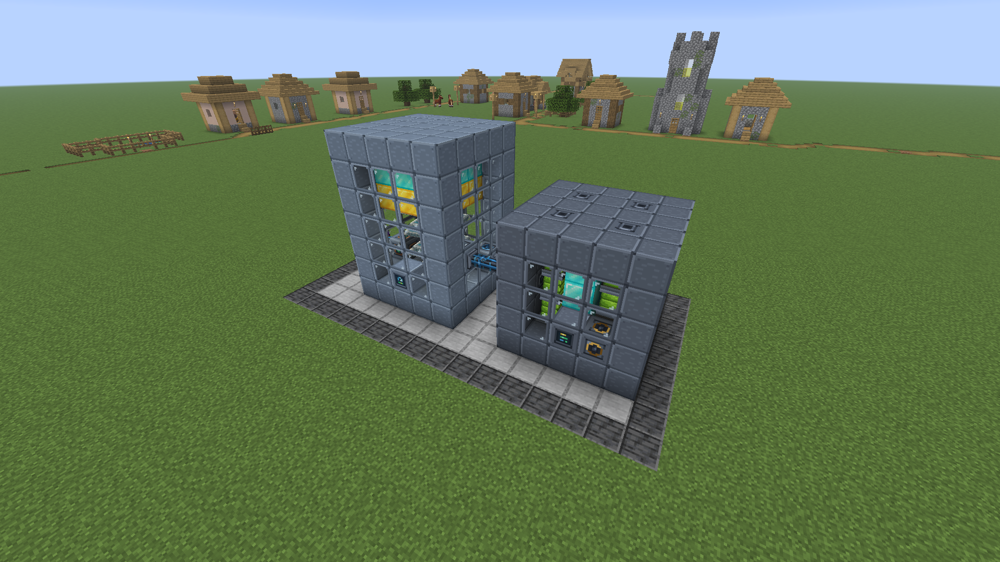
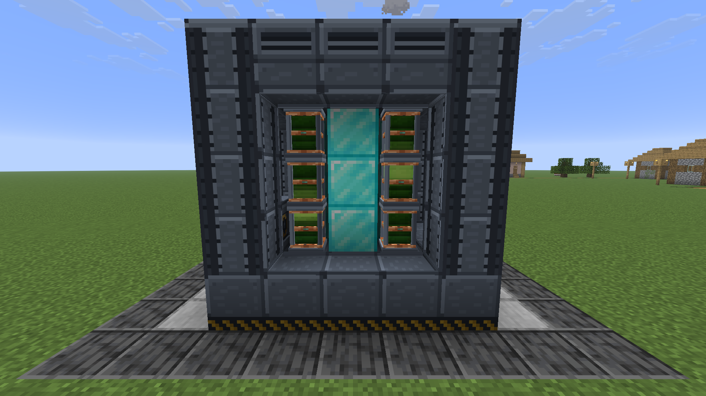
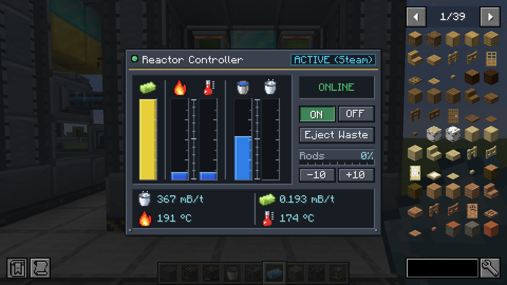
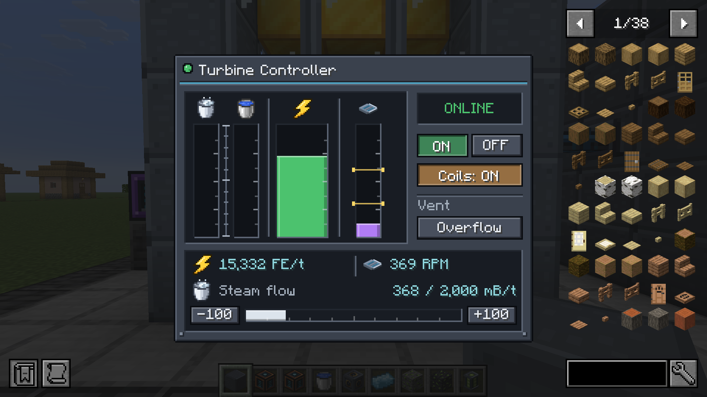

# ☢️ Just Reactors

Standalone multiblock nuclear fission reactor & steam turbine mod inspired by **Extreme Reactors 2**, this is the **Minecraft 1.20.1 (Forge 47)** build; the main version targets Minecraft 26.3. Works out of the box with **Mekanism**, **AE2**, **Powah**, and any Forge Energy (FE) or Forge fluid mod.



|  |  |
|:---:|:---:|
|  |  |

## Features
- **Free-form Multiblock Reactors (`3×3×3` to `32×32×32`, configurable):**
  - **Passive Mode (FE):** Generates Forge Energy directly via `Reactor Power Tap`.
  - **Active-Cooled Mode (Steam):** Add `Reactor Coolant Port`s (Water Inlet / Steam Outlet) to boil Water into **Steam** for Steam Turbines, complete with a controller mode indicator.
  - **Live Fuel Rod Rendering:** Each `Fuel Rod` visually displays stacked **Uranium** and **Cyanite** fill levels inside the reactor glass.
- **Animated Steam Turbine Multiblock (`5×4×5`+):**
  - Build custom turbines with `Turbine Casing`, `Turbine Glass`, `Turbine Rotor Bearing`, `Turbine Rotor Shaft`, `Turbine Rotor Blade`, `Turbine Fluid Port` (Steam Inlet / condensed Water Outlet), `Turbine Power Tap`, `Turbine Redstone Port`, and electromagnetic coils.
  - Includes a spinning 3D rotor renderer, classic ER2 dual-peak RPM efficiency curve (`900` / `1,800 RPM`), flow rate, coil engagement & condensed water Vent controls (`Overflow`, `All`, `Disabled`), and continuous RPM-scaled looping audio.
- **Fuel Reprocessing:**
  - **Cyanite Reprocessor:** Converts `2 Cyanite Ingots + 1,000 mB Water + 20,000 FE` into `1 Blutonium Ingot` (`#justreactors:reactor_fuel`).
- **Configurable Redstone & Computer Automation:**
  - `Reactor Redstone Port` GUI supporting **6 modes**: toggle reactor on Redstone signal, analog control rod insertion, and threshold outputs for stored energy (below/above), fuel temperature (above), and fuel level (below).
  - `Turbine Redstone Port` GUI supporting **7 modes**: toggle turbine, toggle coils, analog steam flow rate, and threshold outputs for rotor RPM and stored energy (below/above).
  - Optional **CC: Tweaked** peripheral support on `Reactor Controller` (`justreactors_reactor`) and `Turbine Controller` (`justreactors_turbine`).
- **Datapack Customization:**
  - Define or override reactor moderators (`data/<ns>/justreactors/moderators/*.json`, 11 built-in) and turbine coils (`data/<ns>/justreactors/turbine_coils/*.json`, 8 built-in) using block IDs or block tags.
- **Progression & Worldgen:**
  - 7 progression advancements guiding players from Graphite and first reactors through active cooling, steam turbines, reprocessing, and Blutonium.
  - Overworld **Uranium Ore** & **Deepslate Uranium Ore** generation.
- **Integrations & Localization:**
  - **JEI** (reprocessing recipes, Reactor Moderators & Turbine Coils categories, info pages), **Jade** tooltips (including multiblock validation errors), optional **CC: Tweaked** peripherals, and full `en_us` and `pt_br` translations.

## Development
```bash
# (no runData here: the recipes, tags and loot tables are kept as JSON in src/generated/resources)
./gradlew build              # build the mod jar
./gradlew runGameTestServer  # run all in-world GameTests
./gradlew runClient          # launch dev client
./gradlew runDemo            # launch dev client with auto-built closed-loop demo station
./gradlew runShots           # build the demo and save the screenshots/GIF frames to run/screenshots
```

## License
Licensed under the **MIT License** — see [LICENSE](LICENSE) for details.
