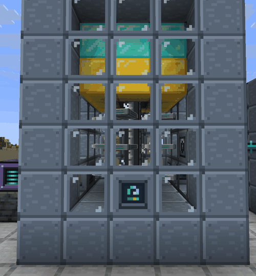

# ☢️ Just Reactors

Standalone multiblock nuclear fission reactor & steam turbine mod inspired by **Extreme Reactors 2**, built for **Minecraft 26.3 (NeoForge)** (with a **1.21.1** backport planned). Works out of the box with **Voltaic Dynamics**, **Mekanism**, **AE2**, **Powah**, and any Forge Energy (FE) or NeoForge Fluid mod.


|  |  |
|:---:|:---:|
|  |  |

## Features
- **Free-form Multiblock Reactors (`3×3×3` to `32×32×32`, configurable):**
  - **Passive Mode (FE):** Generates Forge Energy directly via `Reactor Power Tap`.
  - **Active-Cooled Mode (Steam):** Add `Reactor Coolant Port`s (Water Inlet / Steam Outlet) to boil Water into **Steam** for Steam Turbines, complete with a controller mode indicator.
  - **Live Fuel Rod Rendering:** Each `Fuel Rod` visually displays stacked **Uranium** and **Cyanite** fill levels inside the reactor glass.
- **Animated Steam Turbine Multiblock (`5×4×5`+):**
  - Build custom turbines with `Turbine Casing`, `Turbine Glass`, `Turbine Rotor Bearing`, `Turbine Rotor Shaft`, `Turbine Rotor Blade`, `Turbine Fluid Port` (Steam Inlet / condensed Water Outlet), `Turbine Power Tap`, `Turbine Redstone Port`, and electromagnetic coils.
  - Includes a spinning 3D rotor renderer, classic ER2 dual-peak RPM efficiency curve (`900` / `1,800 RPM`), flow rate, coil engagement & condensed water Vent controls (`Overflow`, `All`, `Disabled`), and continuous RPM-scaled looping audio.
- **Closed Coolant Loop & Heat Exchanger (`3×3×3`+):**
  - Fill a reactor's `Reactor Coolant Port` with **Coolant** instead of Water: each mB carries 4× the heat and leaves as **Hot Coolant**.
  - The `Heat Exchanger` multiblock (`Casing`, `Glass`, `Controller`, `Fluid Port`s, `Heat Exchanger Tube`s inside) cools Hot Coolant back into Coolant and boils Water into Steam — 5 mB of Steam per mB, 25% more than boiling water in the reactor directly.
  - Fluid ports cycle `Input` (Hot Coolant + Water) / `Coolant Output` / `Steam Output`; each Tube cools 25 mB/t. Coolant is crafted from a bucket, packed ice, graphite and redstone.
- **Battery Multiblock (`3×3×3`+):**
  - `Battery Cell`s inside store 10M FE and move 10k FE/t each; `Battery Power Port`s toggle Input / Output.
  - The `Battery Terminal` charges (top slot) and drains (bottom slot) FE items and gives a comparator signal; cells light up with the charge.
  - `Battery Redstone Sensor`: signal when charge is above/below a threshold, full or empty — wire it to a reactor or turbine Redstone Port.
- **Fuel Reprocessing:**
  - **Cyanite Reprocessor:** Converts `2 Cyanite Ingots + 1,000 mB Water + 20,000 FE` into `1 Blutonium Ingot` (`#justreactors:reactor_fuel`).
- **Configurable Redstone & Computer Automation:**
  - `Reactor Redstone Port` GUI supporting **6 modes**: toggle reactor on Redstone signal, analog control rod insertion, and threshold outputs for stored energy (below/above), fuel temperature (above), and fuel level (below).
  - `Turbine Redstone Port` GUI supporting **7 modes**: toggle turbine, toggle coils, analog steam flow rate, and threshold outputs for rotor RPM and stored energy (below/above).
  - Optional **CC: Tweaked** peripherals: `justreactors_reactor`, `justreactors_turbine`, `justreactors_heat_exchanger` and `justreactors_battery`.
- **Datapack Customization:**
  - Define or override reactor moderators (`data/<ns>/justreactors/moderators/*.json`, 11 built-in) and turbine coils (`data/<ns>/justreactors/turbine_coils/*.json`, 8 built-in) using block IDs or block tags.
- **Progression & Worldgen:**
  - 7 progression advancements guiding players from Graphite and first reactors through active cooling, steam turbines, reprocessing, and Blutonium.
  - Overworld **Uranium Ore** & **Deepslate Uranium Ore** generation.
- **Integrations & Localization:**
  - **JEI** and **REI** (reprocessing, Reactor Moderators, Turbine Coils and Heat Exchanging categories, info pages), **Jade** tooltips (including multiblock validation errors), optional **CC: Tweaked** peripherals, **Carry On** protection for assembled machines, and full `en_us` and `pt_br` translations.

## Development
```bash
./gradlew runData            # generate recipes, tags and loot tables
./gradlew build              # build the mod jar
./gradlew runGameTestServer  # run all in-world GameTests
./gradlew runClient          # launch dev client
./gradlew runDemo            # launch dev client with auto-built closed-loop demo station
./gradlew runShots           # build the demo and save the screenshots/GIF frames to run/screenshots
```

## License
Licensed under the **MIT License** — see [LICENSE](LICENSE) for details.
